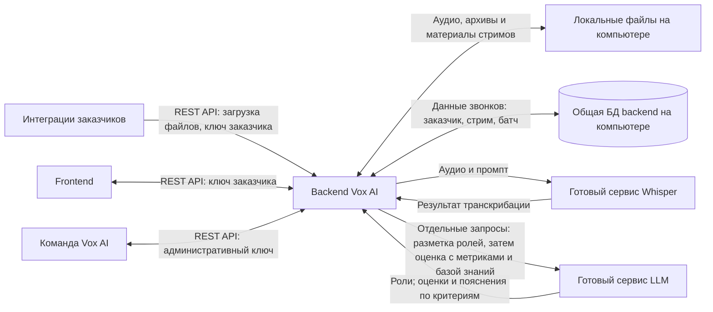
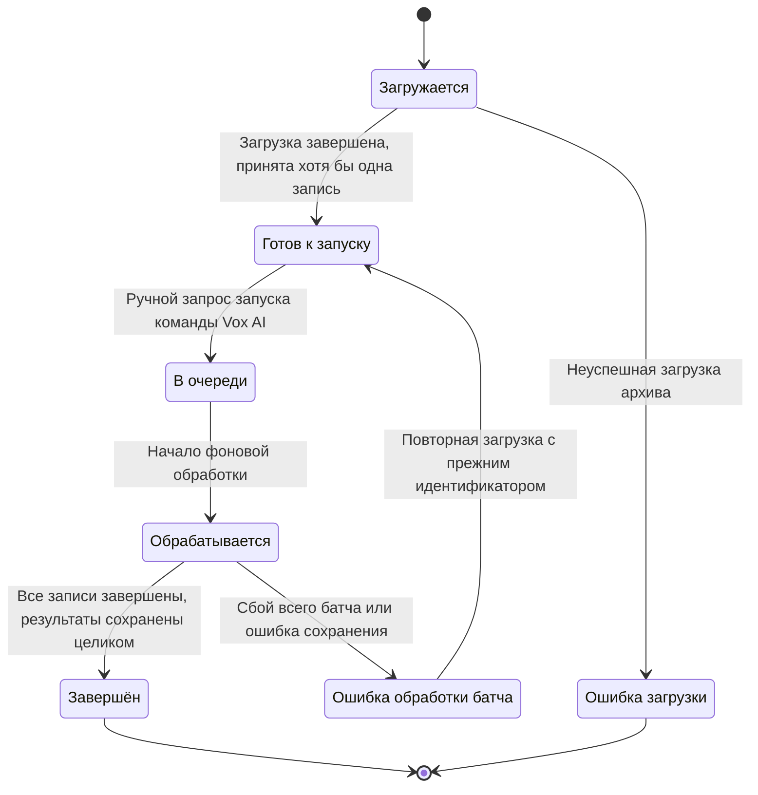

# Vox AI: границы и общая архитектура

Статус: согласованные границы и бизнес-процесс; технический проект подготовлен для проверки, реализация не начата. Основной документ: [проект backend](backend-design.md). Подробные требования и журнал решений: [спецификация](../.scratch/vox-ai-design/spec.md).

## Границы системы

В этой работе проектируется backend. Frontend находится в отдельном репозитории и взаимодействует с backend по REST API.

Whisper и LLM используются как готовые сервисы с API. Backend принимает записи, управляет выполнением стрима, выполняет второй этап обработки транскрипции и формирует отчёты. Развёртывание моделей находится за границами backend.

По указанию пользователя алгоритмы обработки внутри стрима принимаются из существующего репозитория. Порядок вызовов, расчёты метрик, правила оценки и формат результата описаны в [обработке звонка](call-processing.md). Ранее согласованные настройки и неизменяемость стримов сохраняются; отсутствующие в прототипе возможности перечислены там отдельно.

## Ответственность backend

- Создание организаций-заказчиков и выдача их API-ключей через административный REST API.
- Определение заказчика по ключу и изоляция данных организаций; отдельный административный ключ даёт команде Vox AI согласованные права для всех заказчиков.
- Приём явно сформированных батчей через API и ZIP-архивов без пароля через UI; один архив соответствует одному батчу.
- Частичный приём распаковываемого архива: корректные записи попадают в батч, а по повреждённым файлам и файлам неподдерживаемого формата пользователь получает ошибки загрузки.
- Автоматическое завершение загрузки батча из UI-архива после успешной распаковки и приёма хотя бы одной записи; затем батч ожидает ручного запуска командой Vox AI. При отсутствии принятых записей загрузка неуспешна и запуск недоступен.
- Поддержка последовательности API-загрузки: создание батча с выбранным стримом → добавление файлов несколькими запросами → явное завершение загрузки. Завершённая загрузка делает батч готовым к ручному запуску командой Vox AI.
- Частичный приём через API: отказ по одному файлу не мешает принимать остальные; завершить загрузку можно только при наличии хотя бы одной принятой записи.
- Сопоставление повторной загрузки по содержимому файла: внутри батча одинаковое содержимое соответствует одной записи, а в другом батче тот же файл допускается для нового анализа.
- Фиксация состава батча при завершении загрузки: последующее добавление и удаление записей из состава запрещены; дополнительные файлы загружаются в новый батч.
- Хранение данных локально на компьютере в тестовой версии.
- Управление неизменяемыми стримами и сохранение связи батчей с конкретным стримом. Любое изменение стрима требует нового идентификатора, включая содержимое словарей и базы знаний ([ADR-0001](adr/0001-immutable-streams.md)).
- Ручной запуск обработки командой Vox AI через административный REST API.
- Фоновое выполнение батча: API подтверждает принятие запуска без ожидания окончания анализа, а статус и готовый итоговый отчёт предоставляет отдельными REST-запросами.
- Выполнение существующего pipeline: Whisper и коррекция текста → отдельный запрос к LLM для назначения ролей → сборка диалога и расчёт метрик → чтение базы знаний → запрос к LLM для оценки по 11 критериям. При одном говорящем разметка ролей не требует запроса.
- Расчёт итога звонка и применение настройки обнуления при критическом нарушении с сохранением исходных оценок критериев.
- Формирование итогового сводного отчёта по батчу из успешных результатов. Количество записей включает только принятые файлы; ошибки обработки принятых записей и ошибки загрузки имеют отдельные счётчики. Дополнительного запроса к LLM для сводного отчёта нет.

## Выполнение батчей

При массовой загрузке через API заказчик сначала создаёт батч с выбранным стримом, затем добавляет файлы несколькими запросами и явно завершает загрузку. Ошибка приёма одного файла не мешает принимать остальные. Завершить загрузку можно только при наличии хотя бы одной принятой записи. До завершения загрузки батч не готов к запуску. Завершение загрузки делает его готовым к ручному запуску, без автоматического начала анализа.

При загрузке архива через UI пользователь выбирает стрим и передаёт ZIP-архив без пароля через frontend в REST API. После успешной распаковки и приёма хотя бы одной записи backend автоматически завершает загрузку сформированного батча. Батч ожидает ручного запуска командой Vox AI.

Если отдельные файлы распакованного архива повреждены или имеют неподдерживаемый формат, backend принимает корректные записи и показывает ошибки загрузки по проблемным файлам.

Если ни один файл из архива не принят, загрузка считается неуспешной, причины ошибок доступны пользователю, а запуск обработки батча запрещён.

В отчёте количество записей батча включает только принятые файлы. Непринятые файлы показываются отдельным счётчиком ошибок загрузки. Например, из 100 файлов 10 отклонены: в батче 90 записей, дополнительно показаны 10 ошибок загрузки. Оценки рассчитываются по успешно обработанным записям батча.

Файлы с одинаковым содержимым внутри батча соответствуют одной записи независимо от имени файла. Повторная загрузка связывается с существующей записью, не увеличивает счётчики записей или ошибок загрузки и не приводит к повторному анализу внутри батча. В другой батч этот файл можно загрузить для нового анализа.

После завершения загрузки состав батча неизменяем. Добавлять и удалять записи из состава нельзя; для дополнительных файлов создаётся новый батч. Итоговый отчёт относится к зафиксированной группе записей.

После ручного запроса команды Vox AI REST API возвращает подтверждение принятия запуска. Backend выполняет анализ в фоне. Статус батча и готовый сводный отчёт запрашиваются отдельно; сводный отчёт доступен после завершения обработки всех записей. Промежуточная сводка не предоставляется.

Первый запрос запуска готового батча переводит его в очередь. Повторный запрос для батча в очереди, в обработке или завершённого возвращает текущий статус без создания новой задачи или повторного анализа. Результаты завершённого батча сохраняются.

В тестовой версии очередь общая для батчей всех заказчиков. Батчи начинают обработку в порядке принятия ручного запуска: раньше запущенный батч начинает раньше. Повторный запрос запуска сохраняет исходное место в очереди.

Во всей системе одновременно обрабатывается только один звонок, независимо от заказчика и стрима. Остальные записи ожидают своей очереди. Приём файлов и REST-запросы статусов и отчётов остаются доступными во время анализа.

Согласованы статусы: «загружается», «готов к запуску», «в очереди», «обрабатывается», «завершён», «ошибка загрузки» и «ошибка обработки батча».

Завершение пустого API-батча отклоняется; батч остаётся в статусе «загружается». Ошибки отдельных записей отражаются в отчёте завершённого батча. Если все принятые записи завершились ошибкой обработки, батч также завершён, а оценки в отчёте обозначены как «нет данных».

Сбой, прервавший весь батч, или ошибка сохранения результатов переводит его в статус «ошибка обработки батча». Итоговый отчёт такого батча не опубликован; при ошибке сохранения ни один новый результат не остаётся в БД.

После повторной загрузки с прежним идентификатором тот же ошибочный батч возвращается в «готов к запуску». Исходный состав и стрим сохраняются. Команда Vox AI запускает его вручную; весь батч обрабатывается заново, а результаты сохраняются целостно с защитой от дублей. Повторная загрузка сама по себе не запускает обработку.

После перезапуска backend очередь и её порядок сохраняются. Ранее запущенные, но ещё не начатые батчи продолжаются автоматически. Прерванный батч получает статус «ошибка обработки батча» и восстанавливается повторной загрузкой с прежним идентификатором и ручным запуском. Готовые батчи без принятого запроса запуска остаются готовыми; завершённые батчи и сохранённые результаты сохраняются.

Состояния загрузки, запуска и очереди должны переживать перезапуск, а аналитические результаты по-прежнему сохраняются только после обработки батча. Технический механизм фонового выполнения и хранения очереди ещё не выбран. Формат статусов в REST API ещё проектируется.

## Хранение истории результатов стрима

Входная директория является внутренним местом хранения загрузок API/UI. После успешного commit результатов батча его входные файлы сразу удаляются. При ошибке всего батча входы сохраняются до восстановления. Самостоятельного ручного канала помещения файлов в директорию нет. История результатов сохраняется до удаления стрима и удаляется вместе с ним.

После обработки батча данные о его звонках сохраняются в общей БД backend с принадлежностью к заказчику, неизменяемому стриму и исходному батчу. История позволяет сравнивать показатели разных батчей, обработанных в рамках одного стрима. Данные предыдущего стрима сохраняют свой идентификатор при создании нового стрима с изменёнными настройками.

Аналитические результаты сохраняются в БД только после обработки батча. При повторе той же загрузки после сбоя уже сохранённые обработанные записи не должны создавать дубли в БД. Независимая загрузка того же файла в новый батч допускает новый анализ и отдельный результат с принадлежностью к этому батчу.

Интеграция заказчика или frontend создаёт идентификатор загрузки и сохраняет его при повторах после сбоя. Повтор с тем же идентификатором относится к исходной загрузке; новый идентификатор означает независимую загрузку и новый батч. Детальный REST-контракт ещё не выбран.

Результаты батча сохраняются по правилу «всё или ничего»: либо в БД фиксируется весь набор, либо при ошибке сохранения ни один новый результат этого батча не остаётся в БД. Сохранение начинается после окончания обработки батча. Статус «завершён» и доступность итогового отчёта требуют успешной фиксации всего набора. Повтор загрузки с прежним идентификатором не создаёт дубли, в том числе если сохранение состоялось, а подтверждение не было получено клиентом. Техническая реализация целостного сохранения ещё не выбрана.

В тестовой версии общая БД находится на компьютере вместе с остальными локальными данными. «БД стрима» обозначает данные этого стрима в общей БД с привязкой к заказчику, стриму и батчу. Доступ заказчика ограничен его организацией, административный доступ команды Vox AI сохраняется. СУБД и структура таблиц ещё не выбраны.

Для сравнения пользователь выбирает несколько завершённых батчей одного стрима. REST API предоставляет показатели каждого батча: счётчики записей и ошибок, средний итоговый балл из 11, средние оценки 11 критериев, количество и долю критических нарушений. Показатели берутся из сохранённых результатов и предоставляются отдельно по каждому батчу с сохранением правила «нет данных». Детальная схема REST-запроса и ответа ещё проектируется.

## Ограничения тестовой версии

- Поддерживаются звонки с одним сотрудником и одним клиентом.
- Для загрузки архивов через UI поддерживается только ZIP без пароля.
- Все данные пока хранятся на компьютере; отдельного сервиса файлового хранения нет.
- Ручной запуск разрешён в любое время суток. Ночное ограничение целевого режима пока не применяется.
- Во всей системе одновременно обрабатывается только один звонок.
- Текущий ориентир нагрузки — около 300 звонков в одном батче; объём будет меняться. Жёсткий лимит в 300 записей не установлен.
- Обычная длительность звонка — около 5 минут; ориентировочный батч содержит 25 часов аудио. Это объём входных данных; фактическое время обработки ещё не измерено.
- В тестовой версии измеряется фактическое время обработки батчей; жёсткий срок готовности отчёта не установлен. Ожидание запуска и очереди отличается от времени выполнения обработки.
- Пользовательских учётных записей нет; UI и интеграции используют API-ключ заказчика.
- Заказчик загружает записи, выбирает готовый стрим и просматривает отчёты своей организации.
- Команда Vox AI создаёт заказчиков и стримы, выдаёт ключи, запускает батчи и имеет доступ к аудиозаписям и отчётам всех заказчиков.
- Ручной повтор обработки ошибочных записей без повторной загрузки файлов не предусмотрен.
- Руководитель обсуждает отчёт с сотрудником вне Vox AI.
- Employee ID и дата звонка необязательны. Продуктовых ограничений размеров, количества и длительности аудио и whitelist расширений пока нет.
- Отчёты только через REST API. Отзыв/замена ключей и отключение старых стримов для новых загрузок не входят в тестовую версию.
- История не удаляется автоматически; удаление стрима удаляет его данные в БД.

## Технический проект для проверки

- [backend-design.md](backend-design.md): FastAPI, отдельный единственный worker, локальная SQLite и очередь в БД; структура файлов, изоляция данных, фиксация и очистка. Технический выбор является предложением.
- [data-model.md](data-model.md): сущности, связи, ключи, каскады и транзакции.
- [rest-api.md](rest-api.md): загрузки, повторы, ручной запуск, отчёты, сравнение и удаление стрима.
- [acceptance.md](acceptance.md): проверяемые сценарии будущей реализации.
- [call-processing.md](call-processing.md): алгоритмы репозитория и уже согласованные расширения.

Все [семь групп вопросов](../.scratch/vox-ai-design/questions.md) отвечены. Предлагаемые технические детали проверяются в составе целостного проекта; код на этом этапе не пишется.
