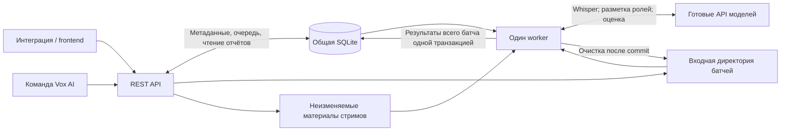

# Vox AI: проект тестового backend

Статус: техническая основа подтверждена пользователем 2026-10-06 в [решении по задаче №01](technical-foundation.md); реализация не начата. Бизнес-решения подтверждены пользователем в [спецификации](../.scratch/vox-ai-design/spec.md). Детали модели данных и REST-контракта остаются проектом для проверки. Все [семь групп вопросов](../.scratch/vox-ai-design/questions.md) отвечены.

## Назначение и границы

Backend принимает записи звонков заказчиков, выполняет выбранный неизменяемый стрим, сохраняет результаты завершённого батча и предоставляет отчёты и сравнение батчей через REST API. Frontend разрабатывается в отдельном репозитории. Обратная связь сотруднику происходит вне системы.

Работа строится вокруг заказчика, стрима, батча и записи звонка. История принадлежит стриму и сохраняется до его удаления. Входные аудио и ZIP удаляются после успешной фиксации результатов батча. При ошибке всего батча входы сохраняются до восстановления.

Whisper и LLM — готовые внешние сервисы. Порядок обработки, формулы метрик и правила критериев принимаются из [существующего pipeline](call-processing.md). Сохраняются отдельные LLM-запросы разметки ролей и оценки; сводные показатели и сравнение батчей вычисляет backend.

## Согласованный бизнес-процесс

1. Команда Vox AI создаёт заказчика и выдаёт API-ключ, затем создаёт для него стрим с промптами, опциями, словарями и базой знаний.
2. Заказчик создаёт батч, загружает записи несколькими запросами и завершает загрузку. Через UI один ZIP без пароля автоматически формирует готовый батч после импорта хотя бы одной записи.
3. Одинаковые байты файла внутри батча соответствуют одной записи. Ошибки загрузки видны отдельно; отсутствие employee ID или даты звонка не препятствует приёму.
4. Команда Vox AI вручную запускает готовый батч. Общая очередь всех заказчиков упорядочена временем принятия запуска. Во всей системе обрабатывается один звонок за раз.
5. Worker обрабатывает записи по стриму. Ошибка отдельной записи фиксируется в итогах; остальные записи продолжаются.
6. После обработки всех записей результаты и сводный отчёт сохраняются в общей БД целиком. Только после commit батч завершён и его отчёт доступен.
7. Backend сразу очищает входную директорию этого батча. В БД остаются метаданные, транскрипции, оценки, пояснения, метрики, ошибки и отчёты.
8. Руководитель получает отчёты и сравнивает несколько завершённых батчей одного стрима. Обсуждение с сотрудником происходит вне Vox AI.

Ориентир теста — 300 звонков по 5 минут, то есть 25 часов входного аудио. Это не лимит и не оценка времени выполнения. Производительность измеряется без жёсткого срока готовности отчёта. Продуктовых ограничений размеров, количества, длительности и whitelist аудиорасширений пока нет; фактическая поддержка кодеков зависит от инструментов и сервиса Whisper.

## Предложенная техническая основа

| Часть | Предложение и назначение |
| --- | --- |
| Язык и обработка | Python; переиспользовать существующие `pipeline.py`, `transcriber.py`, `acoustics.py`, `kb.py`, `analyzer.py`, `checklist.py` и HTTP-клиенты. |
| REST API | FastAPI с Uvicorn; схемы запросов и ответов на Pydantic. Файлы принимаются через `UploadFile` и переносятся в управляемую директорию. FastAPI поддерживает буферизацию загрузок с переходом на диск: [документация](https://fastapi.tiangolo.com/tutorial/request-files/). |
| Общая БД | Локальная SQLite, короткие транзакции и WAL для API и worker на одном компьютере. SQLite описывает атомарную фиксацию и режим одновременного чтения/записи: [atomic commit](https://www.sqlite.org/atomiccommit.html), [WAL](https://www.sqlite.org/wal.html). |
| Версия SQLite | Для WAL нужен runtime с исправлением WAL-reset: предпочтительно SQLite 3.51.3 или новее; проверяется фактическая версия встроенной библиотеки, а не только Python. Исправление описано в [документации SQLite](https://www.sqlite.org/wal.html). |
| Очередь | Таблица в общей БД, отдельный процесс worker. Принятый запуск переживает рестарт; долгие запросы к моделям выполняются вне REST-запроса и транзакции БД. |
| Единственный worker | Эксклюзивная OS-блокировка отдельного файла через `filelock`; локальная Windows/Unix-блокировка удерживается всё время жизни worker. Она освобождается ОС при завершении процесса: [документация](https://py-filelock.readthedocs.io/en/stable/concepts.html). |
| Проверка входов | Локальный `ffprobe` для определения аудиопотока и обнаруживаемых ошибок контейнера, без вызова моделей и перекодирования. Он предоставляет сведения о мультимедиа в машинном формате: [документация](https://ffmpeg.org/ffprobe.html). Скрытая ошибка декодирования, обнаруженная позже Whisper, относится к ошибке обработки записи. |

Внешний брокер очередей и отдельный сервис файлового хранения для этого теста не требуются. Версии зависимостей фиксируются при реализации после проверки совместимости. Выбор SQLite/FastAPI подтверждён пользователем в задаче №01; backend ещё не реализован. Согласованы стандартный sqlite3 без ORM и python-multipart для загрузок. Условия запуска и живой проверки описаны в [технической основе](technical-foundation.md).

## Компоненты



API и worker — отдельные процессы на одном компьютере. Перезапуск только API не объявляет ошибочным батч работающего worker. При запуске нового worker сначала захватывается эксклюзивная блокировка; лишь затем анализируются состояния, оставленные предыдущим завершившимся процессом.

Метаданные загрузки, идентификаторы, очередь и состояние попытки сохраняются до анализа. Аналитические результаты звонков до конца батча находятся в буфере worker и в БД не записываются. При сбое этот незавершённый набор теряется — повторная обработка всего батча является согласованным поведением.

## Входная директория и материалы

Путь задаётся операционной конфигурацией. Пример структуры, а не уже созданные директории:

```text
data/
  db/vox-ai.sqlite3
  locks/worker.lock
  incoming/<customer_id>/<batch_id>/
    archive.zip                  # для UI-загрузки
    files/<call_id>.<suffix>
    staging/                     # незавершённый приём / восстановление
  streams/<stream_id>/materials/
    knowledge-base
    text-corrections.json
    unwanted-expressions.json
```

Директория не является отдельным каналом ручного поступления. Backend назначает внутренние пути, хранит исходные имена как метаданные, импортирует обычные подпапки ZIP и не извлекает файлы за пределы каталога батча. Пустой/нераспаковываемый или зашифрованный ZIP заканчивается ошибкой загрузки; корректные записи распаковываемого архива принимаются независимо от ошибок других файлов.

Не задаются числовые квоты приёма или whitelist расширений аудио. При реализации нужно проверить, что middleware и HTTP-сервер не вводят скрытый прикладной предел размеров. Проверки структуры запроса, ZIP без пароля и наличия аудио остаются частью контракта.

Материалы стрима находятся отдельно от входов батча и не удаляются при его очистке. Они закреплены по содержимому; файл в существующем стриме не перезаписывается. Коррекции предлагаются как JSON-объект «ошибка → замена», нежелательные выражения — JSON-массив строк; применение берётся из алгоритмов репозитория. База знаний использует существующий загрузчик и его 20 000 символов в запросе оценки.

## Целостность, повторы и восстановление

Транзакция фиксации включает результаты записей, оценки критериев, итоговый отчёт, окончание попытки, статус `completed` и регистрацию очистки. Уникальные ключи результатов по батчу/записи предотвращают второй набор. При ошибке всего батча отдельная короткая транзакция устанавливает `batch_failed`, завершает попытку и освобождает прежнее задание очереди. Вызовы Whisper/LLM не выполняются внутри этих транзакций. Предлагается включать foreign keys для каждого подключения SQLite: [документация](https://www.sqlite.org/foreignkeys.html).

Идентификатор загрузки уникален в пределах заказчика. Один заказчик и один `upload_id` определяют один батч. Изменение выбранного стрима с прежним идентификатором возвращает конфликт. Независимый новый анализ требует нового `upload_id` и нового батча.

При восстановлении ошибочного батча повторяются исходные входы с прежним `upload_id`. Новое поколение приёма создаётся один раз для данной неуспешной попытки; повтор HTTP-запроса его не сбрасывает. При возврате существующего call_id файл всё равно отмечается заново принятым в текущем поколении. Проверяется зафиксированный состав по содержимому; новые записи в закрытый батч не добавляются. После полного повторного приёма батч готов к ручному запуску, который получает новое место в FIFO. Попытка обработки выполняется для всего батча. Повтор запроса запуска уже ожидающего, работающего или завершённого батча не меняет очередь и результаты.

После рестарта worker ранее принятые ожидающие батчи продолжаются в сохранённом порядке. Незавершённая попытка без commit становится `batch_failed`; входы сохраняются, требуется согласованное восстановление. Успешно сохранённый батч остаётся завершённым даже при потере подтверждения или сбое до очистки файлов.

После commit немедленно запускается очистка входов. Её техническое состояние хранится отдельно: `pending / done / error`. Ошибка очистки не запускает повторный анализ и не откатывает результаты; очистка повторяется после устранения причины и при рестарте. Удаляются только управляемые входы конкретного батча. Материалы других стримов и общий файл БД не затрагиваются.

## Удаление стрима

Удаление выполняет команда Vox AI через административный API. Оно удаляет стрим, связанные батчи, входные метаданные, попытки, очередь, результаты, транскрипции и отчёты; очищает его материалы и оставшиеся входные каталоги. Заказчик и данные других стримов остаются.

Предложенный технический порядок: при активном приёме файлов или обработке этого стрима вернуть `409 resource_busy`; иначе в одной транзакции зарегистрировать очистку управляемых каталогов и удалить данные каскадно. Задания очистки не удаляются каскадом со стримом. Захват worker задания с переходом queued → processing также атомарен, чтобы удаление и запуск не прошли одновременно. Для завершённых/ошибочных/ожидающих батчей удаление стрима является явным удалением их данных. Остаточная очередь больше не может запустить удалённый стрим. Исчезнувшие ресурсы возвращают `404`.

Это полное удаление, без отдельной функции отключения старого стрима и без автоматического срока хранения. [ADR-0001](adr/0001-immutable-streams.md) уточнён этим правилом.

## Авторизация и конфигурация

Ключ заказчика определяет организацию сервером; клиент не выбирает организацию загрузки. Все чтения, связи стрим–батч–запись и повторные загрузки проверяют владельца. Административный ключ разрешает создание заказчиков/стримов, запуск, удаление стрима и чтение данных всех заказчиков.

Предложение: `Authorization: Bearer <key>`, хеш ключа заказчика в БД, административный ключ в локальной конфигурации. Ключ заказчика выдаётся при создании организации. Пользовательских аккаунтов, отзыва/замены ключей и отключения стримов в API нет. Ключи Whisper/LLM остаются отдельными операционными настройками и не входят в выдаваемые стримы или отчёты.

## Обработка по репозиторию

Основа — HEAD `77a13481af15ceb61b7a31cc25ab949352d70f39`, восемь плоских Python-модулей и CLI. БД, REST и worker пока отсутствуют. Точка интеграции — `process_call` в [pipeline.py](../pipeline.py).

Для backend предлагается передавать функции обработки неизменяемый контекст стрима явно, сохраняя порядок алгоритмов. В снимке фиксируются запрошенные модели Whisper/LLM и влияющие на оценку параметры; их изменение требует нового стрима. Значения по умолчанию для нового стрима можно брать из операционной конфигурации, а адреса подключений и секреты остаются вне снимка. Фактически использованные модельные идентификаторы записываются в результат. Глобальный `settings` не переключается между заказчиками.

Согласованные расширения всё равно потребуют реализации: чекбоксы, файлы словарей, настраиваемый промпт оценки, контроль ровно 11 допустимых оценок и обнуление только итога по критерию 5.2 с сохранением исходных оценок. Их список и отличие от прототипа находятся в [call-processing.md](call-processing.md). Не добавляются запросы LLM для починки ответа, сводки или сравнения.

## Документы для проверки

- [Модель данных](data-model.md): сущности, связи, ключи и границы транзакций.
- [REST-контракт](rest-api.md): операции, форматы, повторы и ошибки.
- [Критерии приёмки](acceptance.md): проверяемые сценарии будущей реализации.
- [Обработка звонка](call-processing.md): исходные алгоритмы и согласованные отличия.
- [Спецификация и журнал](../.scratch/vox-ai-design/spec.md): решения пользователя.

После проверки этого проекта можно формировать реализацию и локальные задачи в `.scratch/`. Сейчас изменена только документация.
