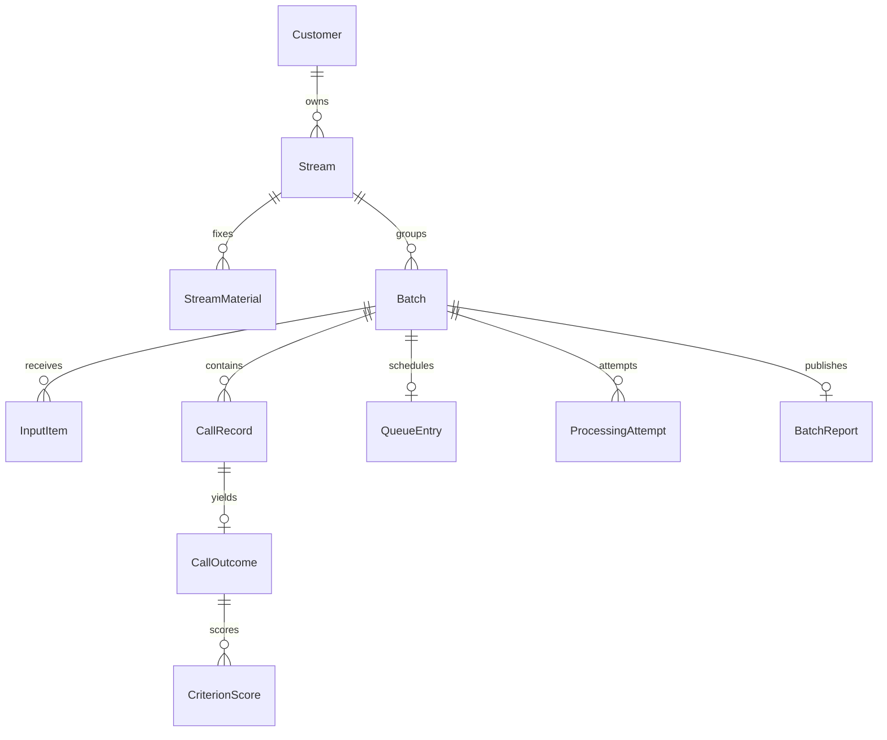

# Vox AI: предлагаемая модель данных

Статус: техническое предложение к [проекту backend](backend-design.md), 2026-10-06.
Общая БД и принадлежность данных заказчику/стриму/батчу согласованы. Реализация
частичная; схема ниже описывает целевую модель, а не перечень готовых таблиц.

На 2026-10-07 фактическая схема находится в `backend/database.py`:
`customers`, `streams`, `batches`, `calls`, `call_results`, `upload_errors`,
`file_duplicates`, `active_uploads`, `batch_archives`, `batch_queue`,
`restoration_receipts`, `input_cleanup`, `deleted_stream_cleanup`.
`batch_archives` сохраняет имя ZIP
и отпечаток состава/метаданных для идемпотентного повтора; сам ZIP хранится в
управляемом каталоге входов до публикации и удаляется вместе с аудио.
Исходы приёма представлены принятой записью
в `calls`, отдельным отказом в `upload_errors` или связью другого имени с записью
в `file_duplicates`. `active_uploads` блокирует закрытие состава при активной
проверке файла; безопасное восстановление регистраций после аварийного завершения
API ещё требуется реализовать. FIFO-очередь и восстановление после перезапуска
worker реализованы в №08; повторный приём отдельных файлов с подтверждениями
`restoration_receipts` — в №09; устойчивая очистка входов — в №10; явное удаление
стрима и независимые задания очистки — в №13. Восстановительный ZIP-импорт ещё
не соединён с №09. Предлагаемые ниже отдельные поколения и сущности попыток
не следует считать существующими таблицами.

## Сущности

| Сущность | Назначение и основные поля |
| --- | --- |
| `Customer` | Организация-заказчик: `id`, `name`, `api_key_hash`, `created_at`. |
| `Stream` | Неизменяемый процесс заказчика: `id`, `customer_id`, `name`, `created_at`, `config_snapshot`, `processor_revision`. |
| `StreamMaterial` | Материал стрима: `id`, `stream_id`, `kind`, `content_hash`, внутренний путь. Виды: база знаний, коррекции, нежелательные выражения. |
| `Batch` | Логическая загрузка: `id`, `customer_id`, `stream_id`, `upload_id`, `source`, `status`, `input_generation`, `restoration_attempt_id`, `sealed_manifest`, времена создания/завершения загрузки/обработки. |
| `InputItem` | Файл API или элемент ZIP: `id`, `batch_id`, поколение приёма, имя/относительный путь, SHA-256, исход `accepted / duplicate / rejected`, `call_id` при связи с записью, причина ошибки. Незавершённый приём обозначается отдельно. |
| `CallRecord` | Принятая уникальная запись: `id`, `batch_id`, `customer_id`, `stream_id`, `content_hash`, исходное имя, внутренний путь входа, nullable `external_employee_id`, nullable `called_at`. |
| `QueueEntry` | Принятый запуск: последовательный `sequence`, уникальный `batch_id`, `enqueued_at`. Порядок не пересчитывается при повторе запуска. |
| `ProcessingAttempt` | Попытка всего батча: `id`, `batch_id`, номер, `started_at`, `finished_at`, исход, причина сбоя. Это служебные метаданные, а не поэтапная фиксация аналитических результатов. |
| `CallOutcome` | Результат записи после завершения батча: уникальный `call_id`, `status succeeded / failed`, `result_json`, код/пояснение ошибки. |
| `CriterionScore` | Исходная оценка критерия успешного звонка: `call_id`, `criterion_id`, `score`, `reason`, `max=1`. |
| `BatchReport` | Единственный опубликованный отчёт: `batch_id`, счётчики, средний итог, средние критериев, критические нарушения, время обработки. |
| `CleanupJob` | Служебная очистка управляемого каталога после commit или удаления стрима: внутренний идентификатор, относительный путь, состояние/ошибка. Не содержит историю оценок. |

Отдельный справочник сотрудников в первой версии не нужен: внешний employee ID сохраняется как необязательная метка. `SPEAKER_XX` относится только к участнику конкретного звонка и не является employee ID.

## Неизменяемый контекст стрима

`config_snapshot` содержит промпт Whisper, редактируемый промпт оценки LLM, три явно заданных чекбокса второго этапа, флаг обнуления итога при критическом нарушении (по умолчанию true), базовый набор 11 критериев и ссылки на фиксированное содержимое материалов.

Существующие параметры алгоритмов, разметка ролей и правила критериев берутся из репозитория. Версия обработчика записывается для интерпретации результатов. Файлы стрима сохраняются отдельно от временных входов батчей. Изменение настроек/материалов означает создание нового `Stream.id`; обновления прежних параметров нет.

Запрошенные модельные идентификаторы Whisper/LLM, фиксированный промпт разметки ролей и влияющие на обработку параметры входят в неизменяемый снимок стрима. Их смена означает новый стрим. Операционная конфигурация задаёт значения по умолчанию при создании; подключения, ключи и URL остаются вне снимка. Фактически использованные названия моделей и версия обработчика записываются в служебную информацию результата; секреты не копируются.

## Ключи и принадлежность

- `Batch(customer_id, upload_id)` уникален: повтор исходной загрузки получает исходный батч, а не новый.
- Стрим батча должен принадлежать его заказчику. Предлагается составной внешний ключ к `(customer_id, stream_id)`.
- Запись связывается с `(customer_id, stream_id, batch_id)`; нельзя прикрепить её к чужому заказчику или другому стриму.
- `CallRecord(batch_id, content_hash)` уникален. Одинаковые байты внутри батча дают одну запись; в другом батче допускается отдельная запись и анализ.
- `InputItem` различает исходные имена/пути, но принятые дубликаты ссылаются на существующий `CallRecord`. Они не увеличивают счётчик ошибок загрузки.
- `CallOutcome(call_id)`, `CriterionScore(call_id, criterion_id)` и `BatchReport(batch_id)` уникальны. Повтор сохранения не создаёт второй набор.
- Успешный исход содержит ровно 11 критериев с баллами 0/0.5/1, а 5.2 — только 0/1. Ошибочный исход не получает фиктивные оценки.
- API всегда проверяет владельца по ключу. Связи и составные ключи дополнительно обеспечивают согласованность БД.

## Что сохраняется до анализа

В БД доступны идентичность заказчика/стрима/батча, метаданные приёма, ошибки загрузки, оригинальные имена, контрольные суммы, закрытый состав, очередь и служебные состояния попытки. Это необходимо для рестарта и защиты от повторов.

`CallOutcome`, `CriterionScore` и `BatchReport` отсутствуют до успешной фиксации всего батча. Результаты отдельных звонков накапливаются в буфере worker. При ошибке одного звонка в набор добавляется исход с ошибкой; обработка остальных продолжается.

## Фиксация и очистка

После завершения обработки одной короткой транзакцией сохраняются все исходы, исходные оценки успешных звонков, отчёт, завершение попытки и `Batch.status=completed`. Очередь освобождается в той же транзакции; очистка входов становится ожидающей. При сбое транзакция не оставляет ни одного нового аналитического результата батча.

Исходные оценки не обнуляются в хранилище. Итог звонка равен их сумме либо 0 при включённом флаге и 5.2=0. Средние критериев используют исходные оценки, средний итог — итог с учётом обнуления.

Канонический `critical_violation` вычисляется из исходной оценки 5.2: score=0 означает нарушение. Это единый факт для подробного отчёта, итога и сводных счётчиков, даже если отдельный флаг LLM ему противоречит.

Захват задания и переход queued → processing выполняются атомарно с проверкой существования стрима. Неуспешная попытка заканчивается отдельной служебной транзакцией: batch_failed, время/причина окончания и удаление старого QueueEntry. После восстановления следующий start создаёт новую строку с новым sequence. При недоступной БД эту служебную фиксацию завершает восстановление после запуска worker.

Следом очищается только входной каталог батча. Удаление физического файла не удаляет `CallRecord`, его имя, транскрипцию или оценки. Входы ошибочного батча сохраняются. Ошибка очистки уже завершённого батча не делает результаты неуспешными; служебная очистка повторяется.

## Восстановление

Повторная загрузка ошибочного батча использует прежний `upload_id`. При первом восстановительном приёме для последней неуспешной ProcessingAttempt атомарно создаётся новое input_generation и сохраняется restoration_attempt_id. Повторы файлов/ZIP в этой же попытке не создают нового поколения. Принятый повторный файл отмечается в текущем поколении даже при возврате ранее существовавшего call_id.

Проверяется совпадение ранее зафиксированного набора уникальных записей с заново принятыми файлами текущего поколения. Требуется повторный приём исходных файлов; простое наличие сохранённых файлов не вводит режим повторного запуска без повторной загрузки. Изменённый состав или стрим — конфликт и самостоятельная новая загрузка с новым идентификатором.

После полного приёма батч снова ready, затем новый ручной запуск создаёт следующую попытку и новую позицию очереди. Завершённый батч с тем же идентификатором возвращает сохранённое состояние, без повторной обработки.

Ошибка первого импорта ZIP без принятых записей (`upload_failed`) не фиксирует состав. Повтор с прежним идентификатором может завершить первоначальную загрузку; изменение стрима при этом не допускается.

## Отчётные показатели

Для опубликованного батча `total_calls = successful_calls + processing_errors`. `upload_errors` — отдельный счётчик непринятых файлов текущего завершённого приёма, а не сумма всех технических повторов HTTP-запросов.

Средние и доля критических нарушений считаются только по успешным исходам. При отсутствии успешных исходов средние и доля равны `null`, количество критических нарушений — 0. Повтор загрузки не увеличивает счётчики; независимый новый батч имеет собственные показатели.

Средние критериев и итогов вычисляются из исходных чисел без промежуточного округления; для REST предлагается десятичное округление средних до двух знаков по half-up. Число JSON не обязано содержать два завершающих нуля. Доля хранится/возвращается как число 0..1, не как процент. Итоговый максимум звонка всегда 11.

## Удаление стрима

В одной транзакции сначала регистрируются CleanupJob с назначенными backend путями, затем удаление `Stream` каскадно удаляет связанные материалы в БД, батчи, входные метаданные, записи, очередь, попытки, исходы, критерии и отчёты. CleanupJob не имеет каскадной связи со стримом и не содержит удалённую историю результатов. Физические каталоги очищаются отдельной устойчивой операцией. Заказчик и другие стримы остаются.

Предложение: не выполнять удаление во время активного приёма или обработки этого стрима; вернуть `409 resource_busy`. После удаления данные не возвращаются из API, автоматического срока хранения и функции отключения стрима нет. Очистка служебных путей может повторяться, но история результатов уже удалена.
